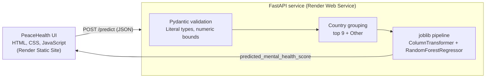
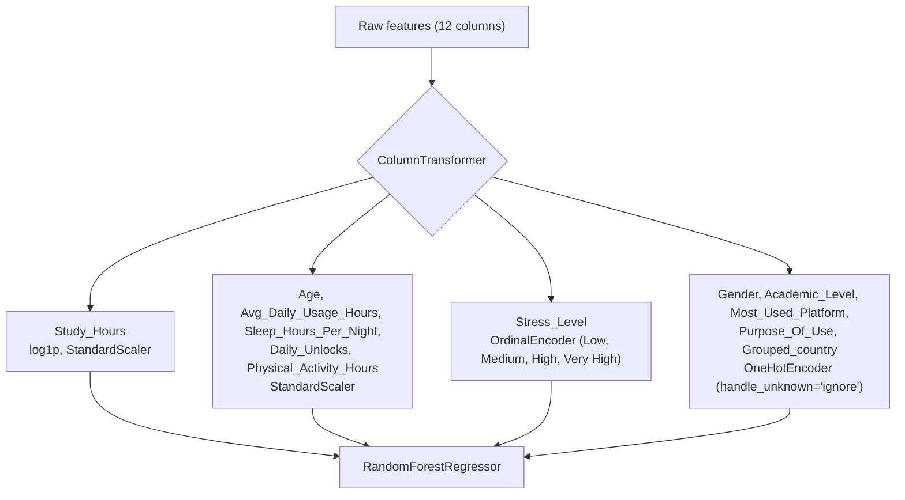

# Mental Health Score Prediction

A supervised regression project that predicts a student's mental health score from social media behaviour, sleep, physical activity, study load and self-reported stress. The trained scikit-learn pipeline is served through a typed FastAPI service and consumed by **PeaceHealth**, a lightweight web interface that visualises the prediction as an animated wellbeing gauge. The backend and the interface are both deployed on Render.

<!-- Live demo: add the Render static site URL here -->
<!-- API docs: add https://<your-service>.onrender.com/docs here -->

---

## Table of Contents

- [Overview](#overview)
- [System Architecture](#system-architecture)
- [Dataset](#dataset)
- [Methodology](#methodology)
- [Model Performance](#model-performance)
- [Design Decisions](#design-decisions)
- [API Reference](#api-reference)
- [PeaceHealth Interface](#peacehealth-interface)
- [Project Structure](#project-structure)
- [Run Locally](#run-locally)
- [Deploy on Render](#deploy-on-render)
- [Limitations](#limitations)
- [Roadmap](#roadmap)
- [Author](#author)

---

## Overview

The repository covers the full path from raw data to a deployed prediction service:

1. Exploratory data analysis, cleaning and outlier handling on a tabular survey dataset.
2. A leakage-safe preprocessing and modelling pipeline built with `Pipeline` and `ColumnTransformer`.
3. Model comparison across a linear baseline and a Random Forest, including randomized hyperparameter search.
4. Serialisation of the complete pipeline (preprocessing and estimator) with `joblib`.
5. A FastAPI service with Pydantic request validation and a response schema.
6. A framework-free frontend that calls the API and renders the result.

## System Architecture



The browser sends raw form values. The server validates them, derives the grouped country feature and passes a single-row DataFrame to the pipeline, which applies the exact transformations that were fitted during training.

## Dataset

Source: the Kaggle dataset **Student Social Media and Mental Health Impact**. The CSV is not included in this repository; download it from Kaggle to rerun the notebook.

| Property | Value |
| --- | --- |
| Rows | 5,000 (4,998 after removing 2 duplicates) |
| Columns | 13 (12 features and 1 target) |
| Missing values | None |
| Target | `Mental_Health_Score`, continuous, mean 6.23 |

| Feature type | Columns |
| --- | --- |
| Numeric | `Age`, `Avg_Daily_Usage_Hours`, `Daily_Unlocks`, `Study_Hours`, `Physical_Activity_Hours`, `Sleep_Hours_Per_Night` |
| Ordinal | `Stress_Level` (Low < Medium < High < Very High) |
| Nominal | `Gender`, `Academic_Level`, `Most_Used_Platform`, `Purpose_Of_Use`, `Country` |

## Methodology

### Exploratory analysis and cleaning

- Examined the target distribution, a numeric correlation heatmap, and the relationship between the score and stress level, daily usage, sleep, study hours and physical activity.
- Detected outliers with the IQR rule: 22 values in `Physical_Activity_Hours` and 2 in `Study_Hours`. Physical activity was clipped at zero to remove unrealistic negative values.
- Removed duplicate rows.
- Computed skewness for all numeric columns. Every value was within 0.44 in absolute terms, so only the most skewed column, `Study_Hours`, was log-transformed.

### Feature engineering

`Country` has more than 100 distinct values, which would add a wide, sparse block of one-hot columns for little signal. It is collapsed into ten groups: nine named countries (India, USA, Canada, Australia, UK, Germany, Mexico, Turkey, France) and `Other`. The same rule is applied inside the API at inference time.

### Preprocessing pipeline

The data is split 70/30 (`random_state=42`) before any fitting, and every transformation is fitted inside a `ColumnTransformer` on the training fold only, which prevents leakage.



### Modelling

The same preprocessor is reused for each estimator so that the comparison isolates the model:

1. **Linear Regression** as a baseline.
2. **Random Forest Regressor** with default settings.
3. **Random Forest Regressor, tuned** with `RandomizedSearchCV`: 15 sampled candidates, 5-fold cross-validation, R² scoring, 75 fits in total.

Search space: `n_estimators` in {100, 200, 300, 400}, `max_depth` in {5, 10, 15}, `min_samples_split` in {2, 5, 10}, `min_samples_leaf` in {1, 2, 4}. Best parameters: `n_estimators=400`, `max_depth=15`, `min_samples_split=2`, `min_samples_leaf=1`.

## Model Performance

Evaluated on the 30% held-out test set.

| Model | Test R² | Train R² | MAE | RMSE |
| --- | --- | --- | --- | --- |
| Linear Regression | 0.7398 | 0.7237 | 0.5362 | 0.6760 |
| Random Forest (default) | **0.8772** | 0.9809 | **0.3480** | **0.4644** |
| Random Forest (tuned) | 0.8714 | 0.9685 | 0.3591 | 0.4753 |

- **R²** is the share of variance in the score explained by the model. **MAE** is the average absolute error in score points. **RMSE** penalises large errors more heavily.
- **Selected model.** The default Random Forest scored best on unseen data, and tuning produced no measurable improvement, so the deployed artefact (`Mental-health-model.pkl`, 100 trees) is the full pipeline around the default forest. On average its predictions fall within about 0.35 score points of the true value.
- **Generalisation gap.** Training R² (0.98) is noticeably higher than test R² (0.88), which indicates that the forest fits the training set more closely than new data. Stronger regularisation is on the roadmap.

## Design Decisions

- **The whole pipeline is serialised, not only the estimator.** The API passes raw columns to `predict()`, and the encoders and scalers inside the pickle guarantee training and serving use identical transformations.
- **The model is loaded once at startup**, not per request, so each prediction is a single in-memory `predict` call.
- **Input validation is declarative.** Pydantic `Literal` types and numeric bounds reject invalid categories and out-of-range values with a descriptive `422` before the model is touched.
- **Unknown categories fail safe.** The one-hot encoder uses `handle_unknown='ignore'`, and unlisted countries fall back to `Other`.
- **A response schema** (`response_model`) guarantees a consistent float output, rounded to two decimals.
- **The scikit-learn version is pinned** to the version used for training (1.7.2), because pickled estimators are not guaranteed to load identically across versions.

## API Reference

Interactive documentation (Swagger UI) is available at `/docs`.

### `GET /`

Returns a greeting. Useful as a quick health check.

### `POST /predict`

| Field | Type | Constraint |
| --- | --- | --- |
| `age` | integer | 10 to 100 |
| `gender` | string | `Male`, `Female` |
| `country` | string | Any value; unlisted countries are grouped as `Other` |
| `academic_level` | string | `High School`, `Undergraduate`, `Graduate` |
| `most_used_platform` | string | `Facebook`, `LinkedIn`, `Instagram`, `Snapchat`, `Twitter`, `YouTube`, `TikTok`, `LINE`, `KakaoTalk`, `VKontakte`, `WhatsApp`, `WeChat` |
| `purpose_of_use` | string | `Networking`, `Education`, `Entertainment`, `News` |
| `avg_daily_usage_hours` | float | 0 to 24 |
| `daily_unlocks` | integer | 0 or more |
| `study_hours` | float | 0 to 24 |
| `physical_activity_hours` | float | 0 to 24 |
| `sleep_hours_per_night` | float | 0 to 24 |
| `stress_level` | string | `Low`, `Medium`, `High`, `Very High` |

```bash
curl -X POST http://localhost:8000/predict \
  -H "Content-Type: application/json" \
  -d '{
    "age": 21,
    "gender": "Male",
    "country": "India",
    "academic_level": "Undergraduate",
    "most_used_platform": "Instagram",
    "purpose_of_use": "Entertainment",
    "avg_daily_usage_hours": 3.5,
    "daily_unlocks": 140,
    "study_hours": 4,
    "physical_activity_hours": 2,
    "sleep_hours_per_night": 7.5,
    "stress_level": "Low"
  }'
```

```json
{ "predicted_mental_health_score": 7.4 }
```

A higher score indicates better wellbeing. Invalid payloads return `422` with the offending field named, and the interface displays that message.

## PeaceHealth Interface

The frontend is a single page written in plain HTML, CSS and JavaScript, with no framework and no build step.

- Dark theme by default with a light theme toggle, glassmorphism cards, custom range sliders and option chips.
- An animated radial gauge with a tick dial, a travelling marker, a count-up value and a colour-coded zone: Optimal Balance, Mild Stress or Elevated Strain.
- Skeleton loading states and explicit error messages for validation failures and an unreachable API.
- Habit breakdown cards and short suggestions derived from the submitted inputs.
- Responsive from mobile to desktop, with reduced-motion support.

The model's raw score is converted to a 0 to 100 index in `frontend/script.js` through two constants, `MODEL_SCORE_MAX` and `HIGHER_IS_BETTER`.

## Project Structure

```
Mental-Health-Score-Prediction/
├── main.py                         # FastAPI application
├── Mental-health-model.pkl         # Serialised preprocessing + Random Forest pipeline
├── Mental_Health_Score_pred.ipynb  # EDA, preprocessing, training, evaluation
├── requirements.txt
├── README.md
└── frontend/
    ├── index.html
    ├── style.css
    └── script.js
```

## Run Locally

Requires Python 3.10 or later.

```bash
git clone https://github.com/Alfez72/Mental-Health-Score-Prediction.git
cd Mental-Health-Score-Prediction

python -m venv venv
source venv/bin/activate              # Windows: venv\Scripts\activate
pip install -r requirements.txt

uvicorn main:app --reload             # API on http://localhost:8000
```

In a second terminal, serve the interface:

```bash
cd frontend
python -m http.server 5500            # UI on http://localhost:5500
```

For local use, `API_URL` in `frontend/script.js` stays as `http://localhost:8000/predict`.

To retrain, download the dataset, update the CSV path in the first cells of the notebook, run all cells and replace `Mental-health-model.pkl`.

## Deploy on Render

The API and the interface are deployed as two separate Render services from the same repository.

### 1. API (Web Service)

1. Push the repository to GitHub, including `Mental-health-model.pkl` (about 26 MB, within GitHub's file size limit).
2. In Render, choose **New > Web Service** and connect the repository.
3. Configure:

   | Setting | Value |
   | --- | --- |
   | Runtime | Python 3 |
   | Build Command | `pip install -r requirements.txt` |
   | Start Command | `uvicorn main:app --host 0.0.0.0 --port $PORT` |

4. After the first deploy, confirm that `https://<service-name>.onrender.com/` responds and that `/docs` loads.

### 2. Interface (Static Site)

1. In `frontend/script.js`, set:
   ```js
   const API_URL = 'https://<service-name>.onrender.com/predict';
   ```
2. Commit and push, then choose **New > Static Site** in Render and connect the same repository.
3. Set **Publish Directory** to `frontend` and leave the build command empty.

### 3. Production hardening

- Restrict CORS in `main.py` by replacing `allow_origins=["*"]` with the static site's origin, for example `["https://<static-site-name>.onrender.com"]`.
- On Render's free tier a web service sleeps after a period of inactivity, so the first request after idle can take up to about a minute while it wakes. The interface shows its loading state during this time.

## Limitations

- **Training range.** The data covers ages 18 to 24, roughly 1 to 9 hours of daily social media use and 62 to 273 daily unlocks. The API accepts wider values, but predictions outside the training range are extrapolations and should not be relied on.
- **Correlation, not causation.** The model captures statistical associations in a survey-style dataset and does not show that any habit causes a change in wellbeing.
- **Not a clinical tool.** This is an educational and portfolio project. It is not a diagnostic instrument and does not replace professional assessment. Anyone who is struggling should speak with a qualified professional or someone they trust.

## Roadmap

- Regularise the Random Forest and widen the search to narrow the train and test gap.
- Benchmark gradient boosting models (XGBoost, LightGBM) on the same pipeline.
- Return feature importances or SHAP values with each prediction.
- Constrain interface inputs to the training range and flag out-of-distribution values.
- Containerise the service with Docker and add automated endpoint tests with CI.

## Author

**Alfez Khan**, Data Scientist (AI and Machine Learning)

- LinkedIn: [linkedin.com/in/alfezkhan-ds](https://linkedin.com/in/alfezkhan-ds)
- Kaggle: [kaggle.com/alfezkhan71](https://kaggle.com/alfezkhan71)
- GitHub: [Alfez72](https://github.com/Alfez72)
- Email: pathanalfaiz72@gmail.com
